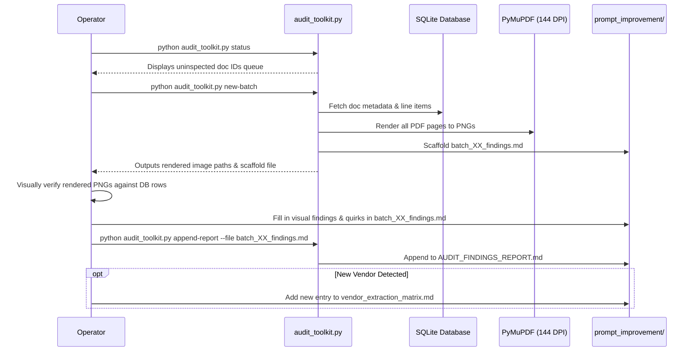

# AAM Merger V3 — Prompt Improvement & Vendor Intelligence Hub

Welcome to the **Prompt Improvement & Vendor Intelligence Hub** (`prompt_improvement/`).

This directory serves as the centralized engineering repository for empirical document audits, multi-vendor visual taxonomies, prompt engineering iterations, and automation scripts for the **AAM Merger V3** ingestion and reconciliation pipeline.

---

## 1. Directory Structure & Key Artifacts

```
prompt_improvement/
├── README.md                          # Authoritative operational guide & toolkit reference (this document)
├── audit_toolkit.py                   # Reusable CLI automation script (renders, inspects, retrieves & scaffolds)
├── vendor_extraction_matrix.md        # Master 20-entity visual extraction matrix (Taxonomy, Labels, Quirks, Rules)
├── initial_batches_brand_retrofit.md  # Brand & layout diagnostics retrofitted for Batches 01–23
├── revised_prompts.py                 # Drop-in candidate prompts incorporating all 40-batch discoveries
├── batch_01_findings.md               # Visual audit report for Docs 9, 10, 11, 28, 29 (Al-Shab / ARO / SANAD)
├── batch_02_findings.md               # Visual audit report for Docs 30, 31, 32, 33, 34
├── ...                                # Batch findings reports for all intermediate batches
└── batch_40_findings.md               # Final audited batch report for Docs 72, 73, 209, 210, 211
```

---

## 2. Executive Summary of Audit Findings (Corpus of 200 Documents)

All 200 real vendor PDFs across 40 batches (Docs 1 through 278) were visually inspected page-by-page against the SQLite database (`data/aam_merger.db`).

### Key Discoveries:
1. **High Visual OCR Baseline**: OpenRouter GPT-5.6 Luna achieves **~98%+ visual transcription accuracy**. Hallucinations are rare and isolated to degraded dot-matrix photocopies (Al-Shab dockets).
2. **Top-20% ROI Boundary Loss**: In legacy `_PAGE_PROMPT`, Step 1 instructed scanning only the `top 20%` of page 1. On pink Drilling Tools and RAAS dockets, the metadata box sits between **15% and 35% height**, causing ~30 delivery notes to return `None` for PO and DN numbers, freezing parent sets in `pending`.
3. **ERP Line Number Formatting Clashes**:
   - **Valaris / Ensco**: POs label lines as `1-1`, `2-1` (Line-Schedule release). Invoices label lines `1`, `2`. Strict string equality failed (`"1"` != `"1-1"`), falsely quarantining Sets 65 and 70 despite 100% perfect quantity, price, and item matches.
   - **Northern Offshore Drilling**: SAP POs use step-10 indexing (`10, 20, 30`). Smaller vendors (e.g. RAK Energy) label sequential `1, 2, 3` in table columns, while writing `Line Item - N` in the description.
4. **Sanitizer Drops on 3-Decimal & European Currencies**:
   - In RAAS Bahrain dockets, 3-decimal BHD currency (`0.086 BHD`) was zeroed out to `0.0`.
   - In KCA Deutag dockets, German European comma decimals (`57,72 SAR`) were dropped or parsed incorrectly.
5. **Multi-Page PO Split False Quarantines**: Multi-page PO contracts split into separate single-page document records triggered Python's naive `if po_doc_count > 1: quarantine()` check (Sets 13, 19, 24, 26).

---

## 3. The Automation Script: `audit_toolkit.py`

`audit_toolkit.py` is a standalone, cross-platform CLI tool built to inspect existing records, automatically render new PDFs to PNGs at high resolution (144 DPI / zoom=2.0) using PyMuPDF, scaffold standardized reports, retrieve past batch/doc findings, and search the vendor matrix.

> **Location Agnostic**: You can run `audit_toolkit.py` directly from **inside `prompt_improvement/`** or from the **workspace root**; it automatically resolves database and asset paths dynamically!

### Quick Start: Running the Toolkit

```bash
# If you are in the workspace root:
python prompt_improvement/audit_toolkit.py status

# If you are inside prompt_improvement/:
cd prompt_improvement
python audit_toolkit.py status
```

---

## 4. Command Reference & Capabilities

### 1. System Status (`status`)
Displays total documents in DB, completed batches, audited document count, remaining uninspected sample queue, and PO set distribution:
```bash
python audit_toolkit.py status
```
*Output includes:*
- Completed batch reports count (Batch 01 to Batch 40).
- Remaining uninspected documents in the database.
- PO set counts grouped by status (`merged`, `quarantined`, `pending`, `mismatched`).

---

### 2. Auto-Creating the Next Batch (`new-batch`)
When new vendor samples arrive, run `new-batch`. The tool automatically:
1. Detects the latest existing batch number (e.g., if Batches 01–40 exist, it selects **Batch 41**).
2. Pulls the next 5 uninspected documents from the database (or accepts custom `--docs`).
3. Automatically renders every page of these documents to high-resolution PNGs (144 DPI) in `scratch_dump/render_all/`.
4. Scaffolds `batch_41_findings.md` in the exact established markdown format.
```bash
# Auto-detect next 5 uninspected documents:
python audit_toolkit.py new-batch

# Or specify a custom limit or specific doc IDs:
python audit_toolkit.py new-batch --limit 5
python audit_toolkit.py new-batch --docs 285,286,287,288,289
```

---

### 3. Retrieving Audit Findings & Records (`retrieve`)
Retrieve audit reports, extracted data, parent PO set statuses, vendor rules, or PO numbers in the exact same format:

#### Retrieve by Batch Number:
```bash
# Print the entire markdown findings for Batch 25:
python audit_toolkit.py retrieve --batch 25

# Export as JSON:
python audit_toolkit.py retrieve --batch 25 --format json
```

#### Retrieve by Document ID:
```bash
# View extracted data, line items, parent PO set, rendered image paths, and audit batch reference:
python audit_toolkit.py retrieve --doc 163
```

#### Retrieve by Vendor or Client Name:
```bash
# Search matrix entries, batch reports, and database documents for "Valaris":
python audit_toolkit.py retrieve --vendor "Valaris"
python audit_toolkit.py retrieve --vendor "RAAS"
```

#### Retrieve by PO Number:
```bash
# Retrieve all documents, line items, and reconcile status for a PO:
python audit_toolkit.py retrieve --po 50116501
```

---

### 4. Inspecting Database Records (`inspect`)
Deep dive into database rows, line items, quantities, and prices:
```bash
# Inspect specific document IDs:
python audit_toolkit.py inspect --docs 194,195,196

# Inspect by batch:
python audit_toolkit.py inspect --batch 36

# Inspect next 5 uninspected documents:
python audit_toolkit.py inspect --uninspected --limit 5
```

---

### 5. High-Resolution PDF Rendering (`render`)
Renders all pages of specified documents to crisp 144 DPI PNG images in `scratch_dump/render_all/docXXX_pX.png`:
```bash
python audit_toolkit.py render --docs 285,286
```

---

### 6. Appending Completed Findings to Master Report (`append-report`)
Once a batch markdown report has been visually audited, append it to `AUDIT_FINDINGS_REPORT.md`:
```bash
python audit_toolkit.py append-report --file batch_41_findings.md
```

---

### 7. Querying the Vendor Extraction Matrix (`matrix`)
Search formatting quirks, terminologies, and prompt rules across 20+ documented vendors:
```bash
# List all registered vendors:
python audit_toolkit.py matrix --list

# Search by keyword, currency, or vendor:
python audit_toolkit.py matrix --query "BHD"
python audit_toolkit.py matrix --query "Schlumberger"
python audit_toolkit.py matrix --query "ADES"
```

---

## 5. Standard Operating Procedure (SOP) When New Samples Arrive

Follow this step-by-step workflow whenever new vendor samples are received:



### Step-by-Step Instructions:
1. **Check Status**: Run `python audit_toolkit.py status` to see how many uninspected documents are in the queue.
2. **Auto-Generate Batch**: Run `python audit_toolkit.py new-batch`. This auto-increments the batch number (e.g. Batch 41), renders all page PNGs at 144 DPI to `scratch_dump/render_all/`, and creates `batch_41_findings.md`.
3. **Visual Verification**:
   - Open the rendered PNG images listed in the scaffold report.
   - Verify:
     - Header numbers (`PO No`, `Buyers Order No`, `Del Note No`, `Invoice No`).
     - Line items (quantities, rates, currencies, decimals).
     - Any quirks (e.g. `1-1` release suffixes, step-10 numbering, 3-decimal currencies).
4. **Finalize Batch Report**: Update Section 2 (Visual vs DB Audit) and Section 3 (Brand Diagnostics) in `batch_41_findings.md`.
5. **Append to Master Log**: Run `python audit_toolkit.py append-report --file batch_41_findings.md`.
6. **Update Master Matrix**: If the new sample introduces a new vendor or format, add a row to [vendor_extraction_matrix.md](file:///c:/Users/malliath/Desktop/aam_merger/prompt_improvement/vendor_extraction_matrix.md).

---

## 6. Standardized Batch Markdown Format

Every batch report generated by `audit_toolkit.py` follows the identical 4-part structure:

```markdown
# Audit Findings — Batch XX (Docs YYY - ZZZ)

## 1. Batch Overview
- **Documents Audited**:
  - `Doc YYY`: `filename.pdf` (Doc Type) — PO Set N (`status`)
- **Primary Companies/Vendors**:
  - Vendor / Client Name

---

## 2. Document-by-Document Visual vs Database Audit

### Doc YYY: `filename.pdf`
- **Visual Document Type**: `DN / SI / PO`
- **DB Document Type**: `DN / SI / PO`
- **Visual Metadata**:
  - Document Number: `...`
  - PO Reference: `...`
- **Visual Line Items**:
  - [Visual lines observed on rendered image]
- **DB Extracted Items**:
  - `po_no_normalized`: `...`
  - Line `N`: `Description` | Qty `X` | Unit Price `Y`
- **Rendered Images**: `['scratch_dump/render_all/docYYY_p1.png']`

---

## 3. Brand & Document Diagnostics

| Attribute | Visual Feature on Document | Prompt Engineering Implication |
|---|---|---|
| **Header Placement** | [Location & labels on page 1] | [ROI or alias rule] |
| **Line Numbering** | [Column format (1, 10, 1-1)] | [Line key normalization] |
| **Financial Fields** | [Currency & decimals] | [Sanitizer decimal rule] |

---

## 4. Prompt Engineering & Pipeline Recommendations
1. **Header Extraction Rules**: [Specific prompt directives]
2. **Line Item Reconciliation**: [Specific backend matching directives]
```

---

## 7. Master Candidate Prompts

The candidate prompt definitions incorporating all lessons from all 40 audited batches are located in [revised_prompts.py](file:///c:/Users/malliath/Desktop/aam_merger/prompt_improvement/revised_prompts.py).
- **Expanded Header ROI**: Extends scan boundary to top 35% page height to capture Drilling Tools pink forms and RAAS dockets.
- **Negative Rig Constraints**: Explicitly forbids rig identifiers (`ADES 688`, `VALARIS 110`, `C016`) from masquerading as order numbers.
- **Header Label Aliases**: Captures `Del. Note No`, `Buyers Order No`, `DPO Number`, `Requisition No`.
- **Line Release Normalization**: Drops schedule suffixes (`1-1 → 1`) to enable instant auto-merging with vendor invoices.
